

  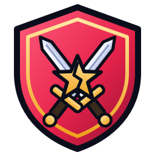

<h1 align="center">The only Clash of Clans bot you will ever need!</h1>

<b>Clash Rekt Bot</b> farms, upgrades and plays Clash of Clans for you on any Android emulator, on Windows, macOS and Linux. One click to start, no setup knowledge needed.

  
  
  
  
  

  
  
  
  

  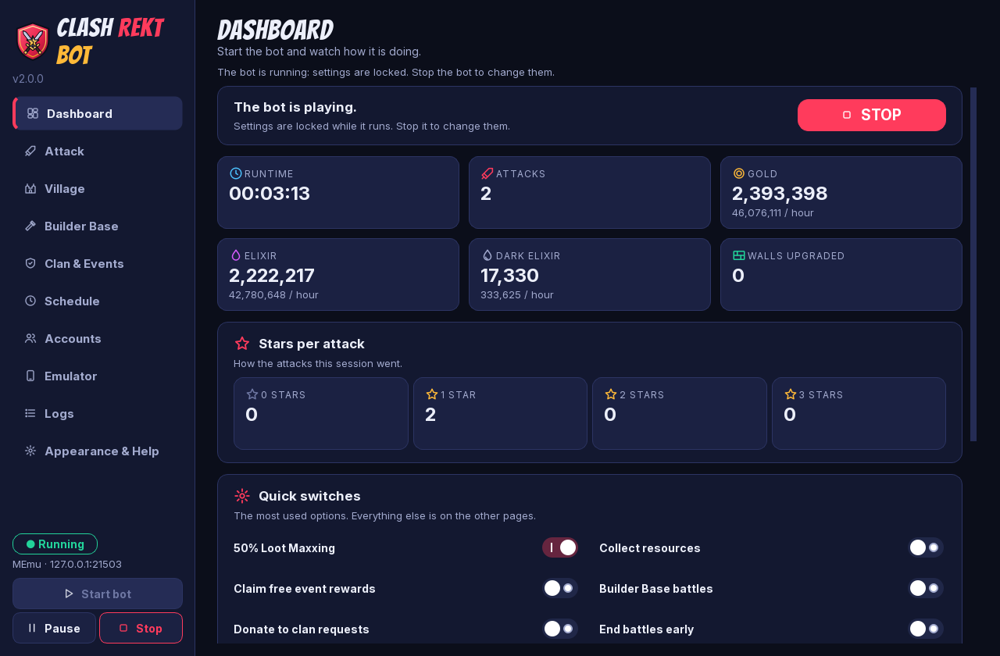
   The dashboard after two real <b>50% Loot Maxxing</b> attacks: 2.39M gold and 2.22M elixir in 3 minutes.

---

## What it does

| | |
|---|---|
| **50% Loot Maxxing** | One switch for fast 1-star loot attacks: 50% damage gives the star, the star gives the loot bonus, and the battle ends in about 15 seconds instead of 3 minutes. Every troop, spell, hero and siege machine goes in, and every attack is varied. [More below.](#50-loot-maxxing) |
| **Farming attacks** | Searches for bases with the loot you want and attacks them with your chosen strategy: Electro Dragons, Dragons + Riders, Valkyrie Quake, Super Minions, Super Barbarians, BArch/Goblins, Thrower Smash or any MyBot/PHMOD-style CSV script. It uses the strategy that matches the army you actually trained. |
| **Village chores** | Collects resources and the loot cart, claims free event rewards, removes obstacles, and runs building, hero, lab, pet, equipment and wall upgrades. It also handles the Helper Hut and keeps Super Troops boosted. |
| **Builder Base** | Builder Base battles on a timer, or a **Builder Base only** mode, plus Builder Base upgrades. |
| **Clan & events** | Requests and donates troops, plays Clan Games, and handles Clan Capital raids. Ranked tournaments and Clan War attacks are both **off unless you turn them on**. |
| **Plays like a person** | Set play hours, take random breaks and stop automatically after N attacks, hours or loot gained. |
| **Many accounts** | Rotates between your Supercell ID accounts. Each account can have its own settings. |
| **Any scenery** | Some sceneries zoom out much further than others. The bot measures your village and zooms to the right level by itself, once per scenery. |
| **Keeps going** | Reconnects when the emulator drops, restarts a frozen emulator, recovers from the game hanging, and stops cleanly the moment you press Stop. |

Everything that **spends resources** is **off** until you turn it on.

## Quick start

### 1. Get an emulator with Clash of Clans
See [Emulator setup](#emulator-setup) below. In short, you need any Android emulator set to **1600 x 900, 300 DPI**, with **ADB on**, Clash of Clans installed, and your account logged in.

### 2. Download Clash Rekt Bot
Download the latest release zip (or **Code → Download ZIP**) and unzip it anywhere, for example to your Desktop.

### 3. Start it
| System | Do this |
|---|---|
| **Windows** | Double-click **`Start Clash Rekt Bot.bat`** |
| **macOS** | Double-click **`Start Clash Rekt Bot.command`**. The first time, right-click it → **Open** → **Open**, because macOS asks before running downloaded scripts. |
| **Linux** | Run `./start-clash-rekt-bot.sh` |

The **first start** takes a few minutes. It downloads its own copy of Python 3.12, the libraries it needs and Google's `adb` into a hidden `.crb` folder inside the app folder. Nothing is installed on your system and no admin rights are needed. On Windows it also puts a **Clash Rekt Bot** shortcut on your desktop. After that, every start takes a couple of seconds.

### 4. Connect and play
1. Open your emulator.
2. In Clash Rekt Bot, go to **Emulator** → **Find running emulators**, double-click yours, then press **Test connection**. Every line should show ✓.
3. Pick your strategy on the **Attack** page and switch on what you want on the other pages.
4. Press **START**.

---

## Tested setup

Everything in this README was built and tested on exactly this setup. Matching it is the surest way to get the same results.

| | Version / setting |
|---|---|
| **Emulator** | **MEmu 9.5.8.0** (Microvirt), Android **9** (64-bit, x86_64) |
| **Emulator screen** | **1600 x 900**, **300 DPI**, ADB port **21503** |
| **Clash of Clans** | **18.647.5** |
| **Computer** | Windows 11 Pro (build 26300) |
| **Python** | 3.12 (installed by the launcher; you don't need your own) |

**BlueStacks 5.21.660.2003** was tried too: the bot runs on it, but BlueStacks' virtual machine shut itself down every few minutes. Use MEmu for long runs.

## Emulator setup

The bot sees the game through screenshots, so the emulator screen must be **1600 x 900 (landscape) at 300 DPI**. The connection test in the app tells you if something is off.

| Emulator | Systems | Resolution / DPI | ADB | Bot preset & port |
|---|---|---|---|---|
| **MEmu** *(recommended)* | Windows | Settings → Display → Custom **1600 x 900**, **300 DPI** | On by default | MEmu · 21503 |
| **BlueStacks 5** | Windows | Settings → Display → **1600 x 900**, Pixel density **300** | Settings → Advanced → **Android Debug Bridge** on | BlueStacks · port shown under ADB (often 5555/5556) |
| **LDPlayer 9** | Windows | Settings → Advanced → Custom **1600 x 900**, **300 DPI** | Settings → Other → ADB debugging → **Open local connection** | LDPlayer · 5555 |
| **Nox** | Windows | Settings → Performance → Custom **1600 x 900**, **300 DPI** | On by default | Nox · 62001 |
| **MuMu Player 12** | Windows | Settings → Display → Custom **1600 x 900**, **300 DPI** | On by default | MuMu Player · 16384 |
| **BlueStacks Air** | macOS (Apple Silicon) | Settings → Display → **1600 x 900**, **300 DPI** | Settings → Advanced → ADB on | BlueStacks · use **Find running emulators** |
| **MuMu Player Pro** | macOS | Settings → Display → **1600 x 900**, **300 DPI** | On by default | MuMu Player · use **Find running emulators** |
| **Anything else** (Android Studio emulator, Genymotion, a real phone over USB/Wi-Fi) | Any | 1600 x 900, 300 DPI | Developer options → USB debugging | **Other** · its ADB port |

Emulator menus move around between versions. If a setting isn't where the table says, look for "Display", "Resolution", "DPI" and "ADB" in its settings.

After changing the resolution or DPI, **restart the emulator**.

### Clash of Clans
1. Open the **Play Store** in the emulator, sign in with a Google account and install **Clash of Clans**.
2. Log into your village: Settings (gear) → **Supercell ID**.
3. Set the game language to **English**, because the bot reads English text on buttons.
4. Close any open windows so you are looking at your village, then start the bot.

---

## 50% Loot Maxxing

The idea: **50% damage gives 1 star, and the star unlocks the attack's star bonus**. So instead of playing a full 3-minute attack, the bot sends everything in at once, gets past 50% with the star as fast as possible, takes the loot and leaves. That's about 15 seconds of battle and many more attacks per hour.

**How it attacks** (taken from a real replay that scored 55%, 1 star, 451k gold, 863k elixir and 11.6k dark):

| Step | What happens |
|---|---|
| 1 | **All the dragons in about 1 second**, spread round **three sides** of the base (left corner, both bottom edges, right corner), just outside the outer ring where the collectors and storages are. Any other troops follow on the same path. |
| 2 | **Heroes on the fourth side** (the two top edges), about 0.6 s apart, with the **siege machine** among them and pets with their heroes. |
| 3 | **Rage** (and Haste/Heal/Jump/Invisibility) on the heroes' path as they walk in. |
| 4 | **All Earthquakes (or Lightning) stacked on the Town Hall** / core. |
| 5 | **Freeze and Totem** on the core as the heroes close in, then the hero abilities. |
| 6 | **Revive** over the heroes, and any other spell on the core, so nothing is left unused. |
| 7 | **End Battle** as soon as the damage target is reached **and** the star is in. It never leaves without the star, and leaves early if the damage stops rising for ~20 s. |

**Replay army:** 11 Electro Dragons; Archer Queen, Barbarian King, Grand Warden, Minion Prince (with pets); 11 Earthquake, 2 Freeze, 1 Totem; any siege machine. **Other armies work too:** the biggest troop group circles the base, and every spell and siege machine gets used.

**Every attack is different.** Tap spots, spacing, sweep direction, which top edge each hero takes, hero order, every pause (centred on the replay's own rhythm), where the spells land, when the abilities fire, and the exit point (a random 50–56%) all change from attack to attack. This makes the bot look much less mechanical, but no bot is undetectable (see [Fair play](#fair-play)).

**To use it:**
1. In the game, save the replay army in a free army slot.
2. In the app, open **Attack → 50% Loot Maxxing** and switch it on.
3. Pick that slot under **Army slot for this strategy**. Leave it on **Current Army** to use whatever is trained.

  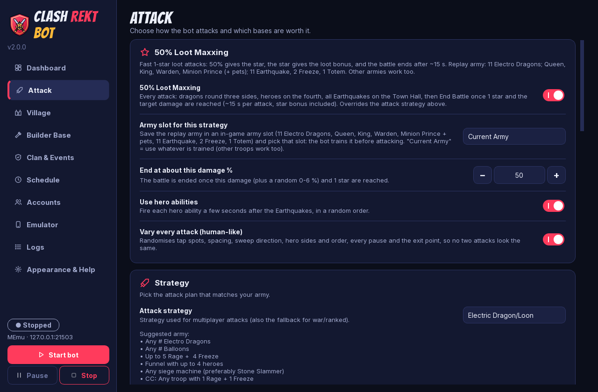

---

## Using the app

| Page | What's there |
|---|---|
| **Dashboard** | The big **START / STOP** button, live loot and stars, quick switches and recent activity. |
| **Attack** | Strategy and army, minimum loot, ending battles early, ranked tournaments and Clan War. |
| **Village** | Collecting, upgrades, Helper Hut and Super Troops. |
| **Builder Base** | Battles, Builder Base only mode and upgrades. |
| **Clan & Events** | Donations, Clan Games and Clan Capital. |
| **Schedule** | Play hours, random breaks and stopping automatically. |
| **Accounts** | Several Supercell ID accounts: order, on/off, per-account settings. |
| **Emulator** | Pick your emulator, find it, test the connection, and the scenery zoom calibration. |
| **Logs** | Everything the bot does, live, with filters and search. |
| **Appearance & Help** | Colour scheme (Rekt Night, Rekt Day, **High Contrast**), text size and reduce motion. |

Settings are locked while the bot runs. Stop it to change them.

### Screenshots

<table>
  <tr>
    <td align="center"> <b>Dashboard</b></td>
    <td align="center"> <b>Attack</b></td>
  </tr>
  <tr>
    <td align="center">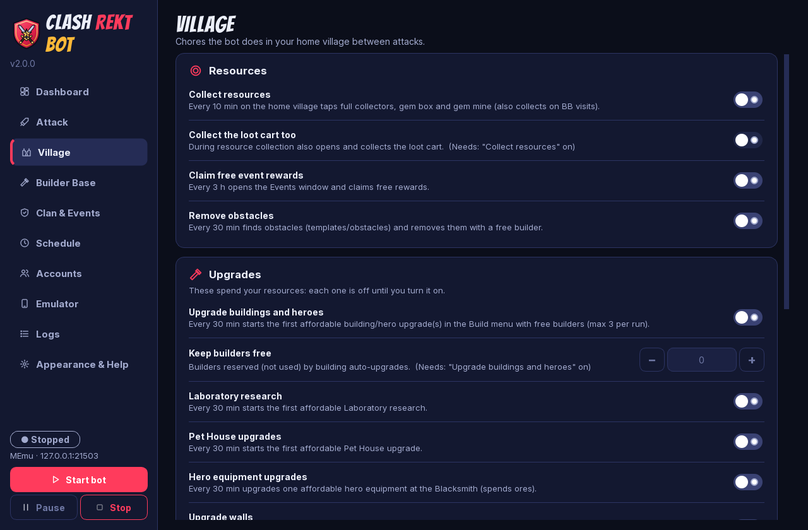 <b>Village</b></td>
    <td align="center">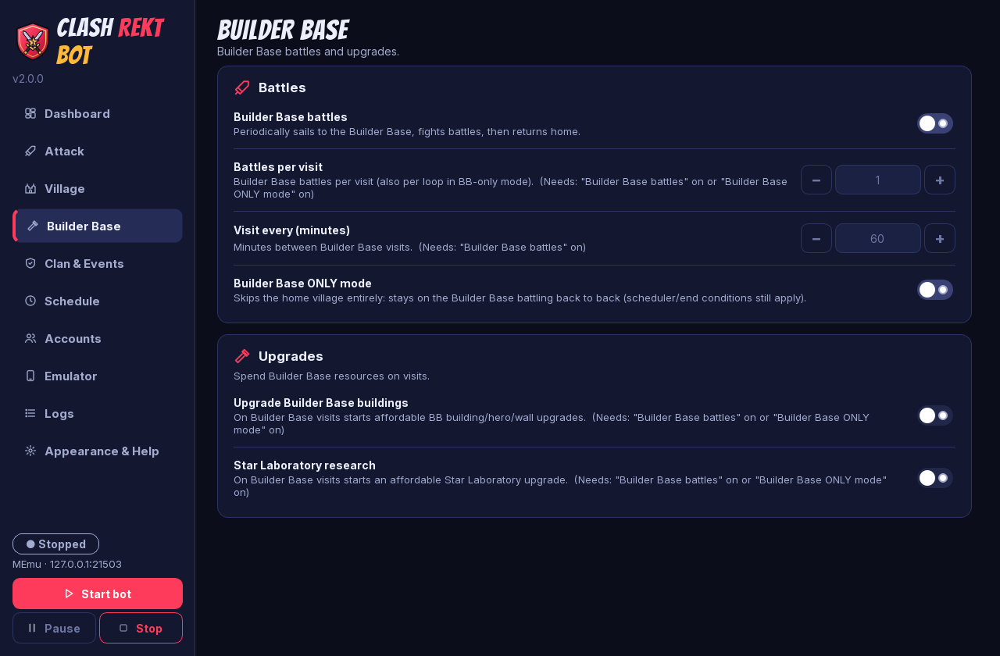 <b>Builder Base</b></td>
  </tr>
  <tr>
    <td align="center">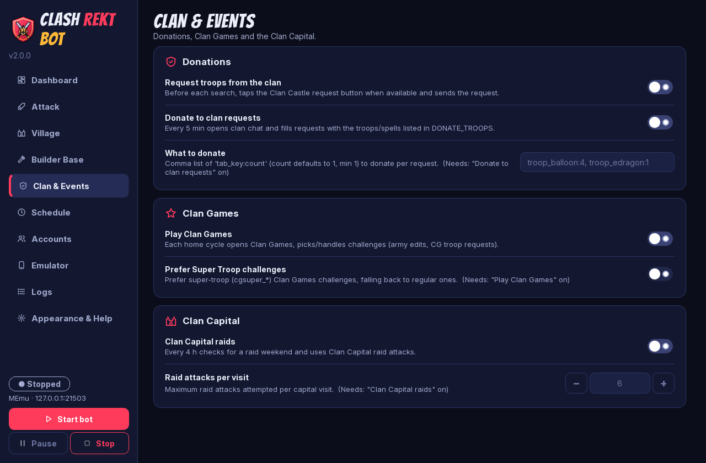 <b>Clan &amp; Events</b></td>
    <td align="center">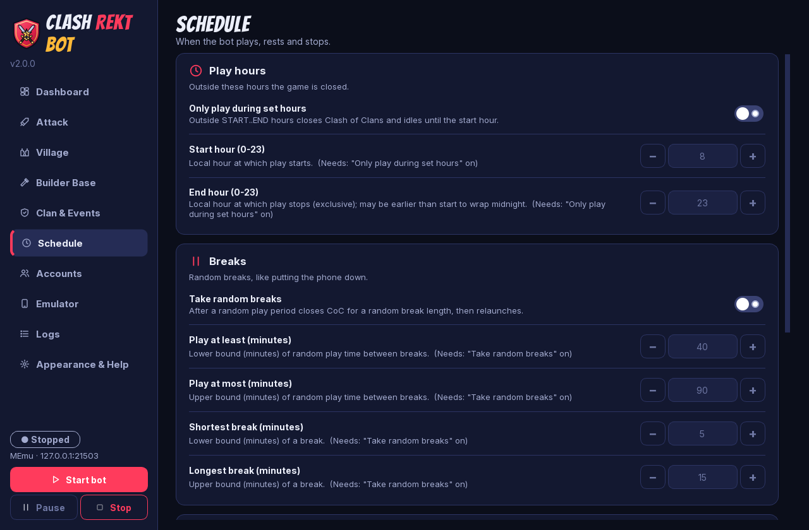 <b>Schedule</b></td>
  </tr>
  <tr>
    <td align="center">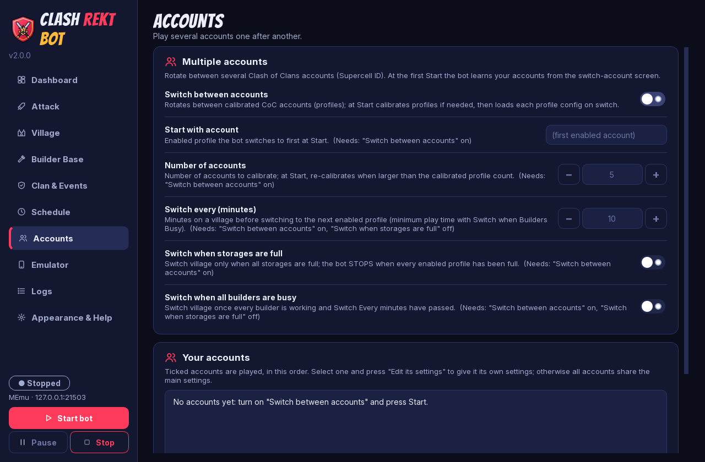 <b>Accounts</b></td>
    <td align="center">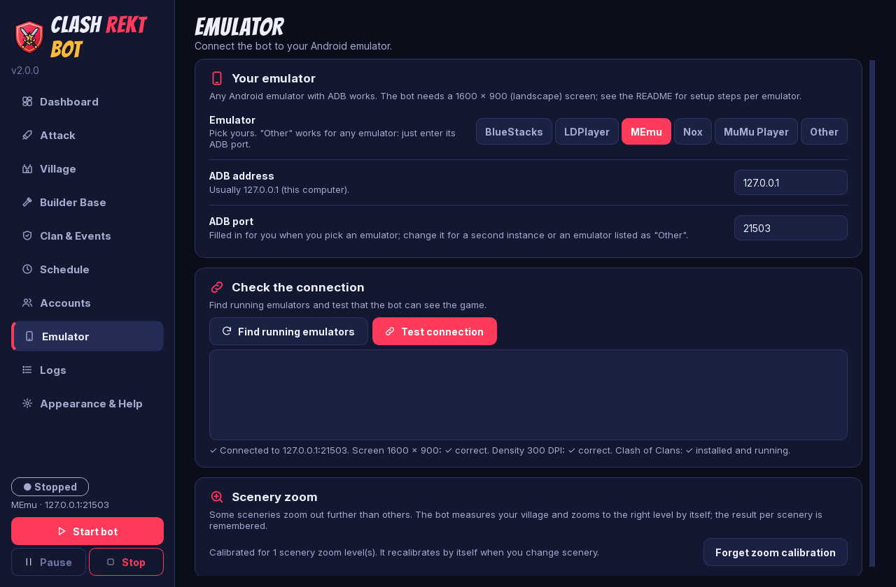 <b>Emulator</b> (after a real connection test)</td>
  </tr>
  <tr>
    <td align="center">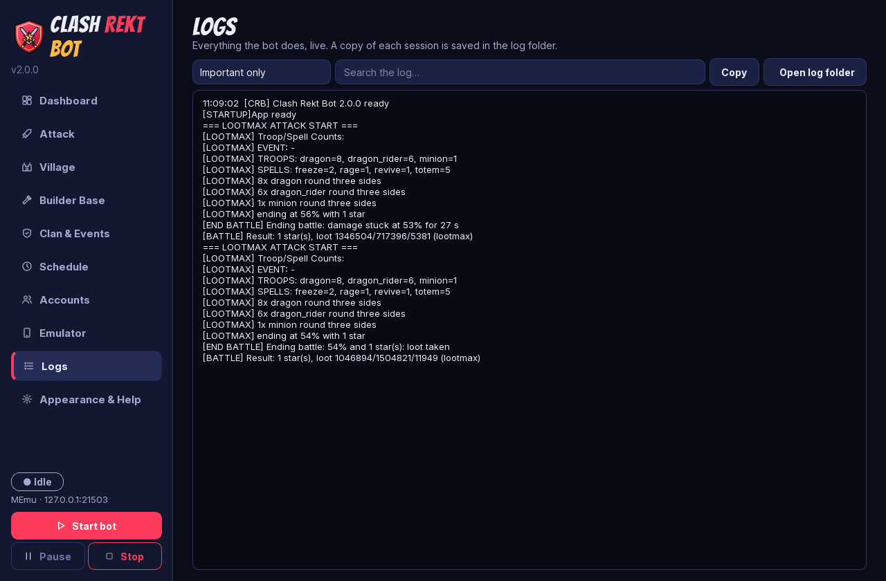 <b>Logs</b> (two real Loot Maxxing attacks)</td>
    <td align="center">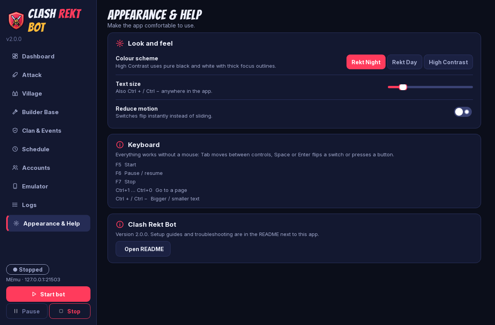 <b>Appearance &amp; Help</b></td>
  </tr>
  <tr>
    <td align="center">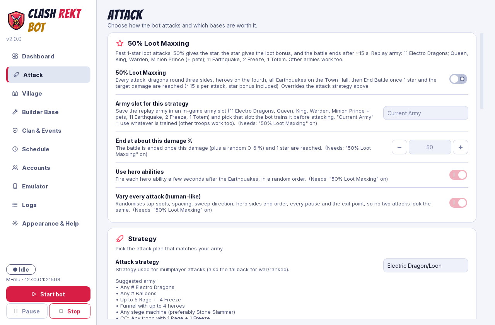 <b>Rekt Day</b> colour scheme</td>
    <td align="center">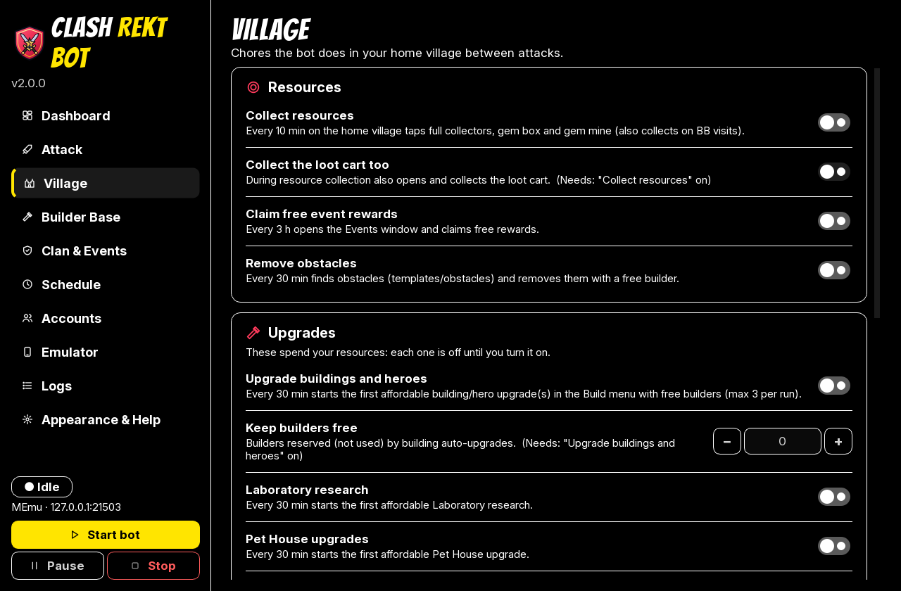 <b>High Contrast</b> scheme at 120% text</td>
  </tr>
</table>

**Keyboard:** everything works without a mouse.
- **Tab** moves between controls.
- **Space** or **Enter** flips a switch or presses a button.
- **F5** starts, **F6** pauses and **F7** stops the bot.
- **Ctrl+1 … Ctrl+0** jump to a page.
- **Ctrl + / Ctrl −** change the text size.

### Multiple accounts
1. Turn on **Accounts → Switch between accounts** and set the number of accounts.
2. Press **START**. The bot opens the Supercell ID switch screen once and learns your accounts. Follow the pop-up.
3. Tick, untick or reorder accounts on the Accounts page. Select one and press **Edit its settings** to give it its own settings.

Reading account names uses Tesseract OCR:
- **Windows:** included in the release zip.
- **macOS:** `brew install tesseract`.
- **Linux:** `sudo apt install tesseract-ocr`.

### Sceneries
Nothing to do. The first time the bot needs your village at the right size (for collecting, the Helper Hut and so on), it calibrates the zoom for your scenery, which takes about a minute. The result is remembered. If you change scenery, it recalibrates by itself. **Emulator → Forget zoom calibration** starts over.

---

## Troubleshooting

| Problem | Fix |
|---|---|
| *"No emulator answered at 127.0.0.1:…"* | Start the emulator first and check ADB is on. Use **Emulator → Find running emulators** to get the right port. |
| Connection test shows ✗ next to the screen size or DPI | Set **1600 x 900** and **300 DPI** in the emulator and restart it. |
| Taps land in the wrong place | Same as above. Also check the game language is **English**. |
| First start fails ("Setup failed") | Check your internet connection and start again. To rebuild the setup from scratch, run `Start Clash Rekt Bot.bat -Repair` (Windows) or `./start-clash-rekt-bot.sh --repair` (macOS/Linux). |
| macOS says the script "can't be opened" | Right-click **Start Clash Rekt Bot.command** → **Open** → **Open**. |
| Linux: window doesn't open | Install the Qt runtime libraries: `sudo apt install libxcb-cursor0 libxkbcommon-x11-0 libegl1`. |
| The bot does something odd | Open **Logs**, set the filter to **Problems only**, and look at the screenshots saved in `runtime/logs`. |
| Want the old window back | Start `runtime/run_bot.py --classic`. |

## Files and privacy
- **Settings:** `runtime/profiles/` (main settings, plus one folder per account).
- **App preferences:** `runtime/bot.config` (theme, text size, window position).
- **Logs and screenshots:** `runtime/logs/`. Each session's log is kept for 7 days.

Nothing is sent anywhere: the bot only talks to your emulator. To uninstall, delete the folder (and the desktop shortcut).

## Fair play
Automating Clash of Clans is against Supercell's Terms of Service, and accounts that use bots can be banned. Use Clash Rekt Bot at your own risk, ideally on an account you can afford to lose. The bot plays at human speed and takes breaks if you enable them, but no bot is undetectable.

## Star history

<a href="https://star-history.com/#PriyanshuGeTRekT/Clashofclans-REKTBOT&Date">
  <picture>
    <source media="(prefers-color-scheme: dark)" srcset="https://api.star-history.com/svg?repos=PriyanshuGeTRekT/Clashofclans-REKTBOT&type=Date&theme=dark">
    
  </picture>
</a>

---

Clash Rekt Bot is not affiliated with, endorsed by or connected to Supercell. Clash of Clans is a trademark of Supercell Oy.

